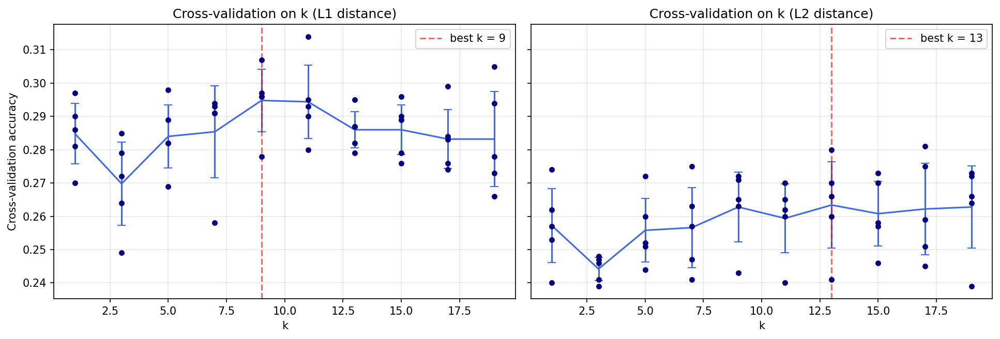
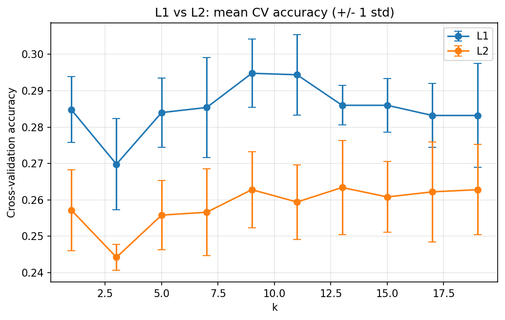
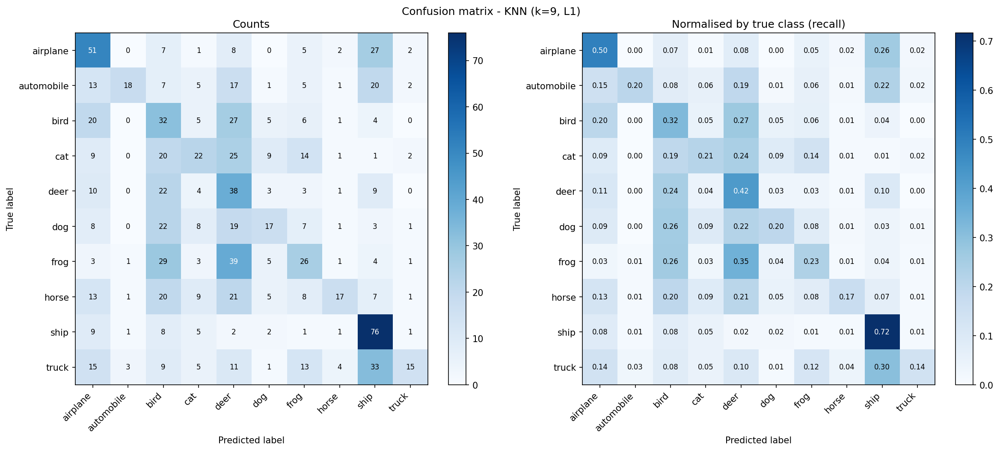
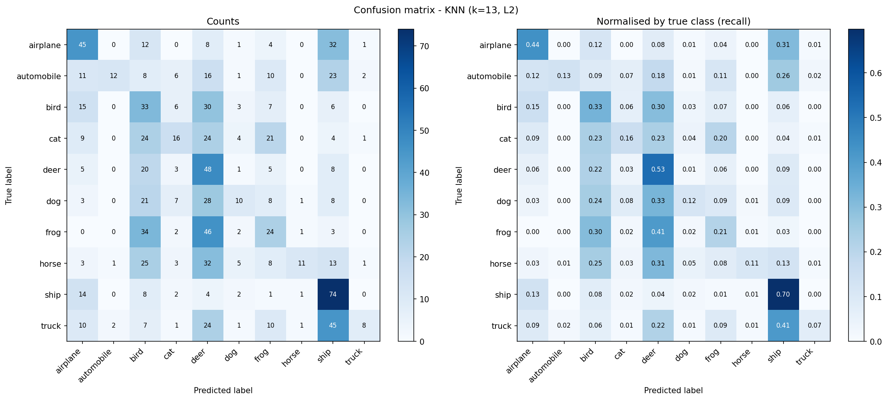
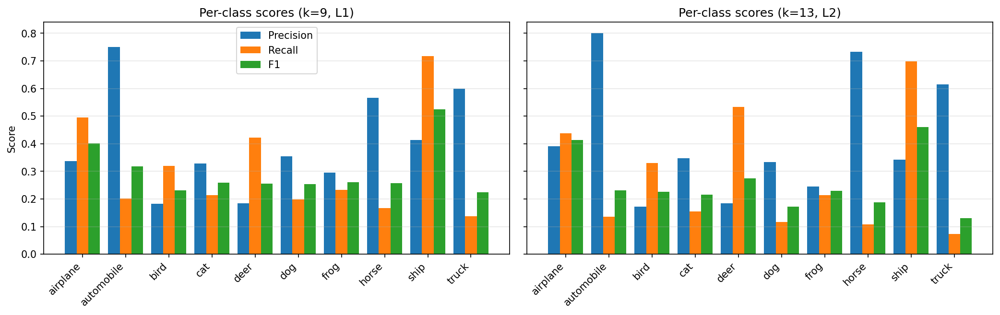
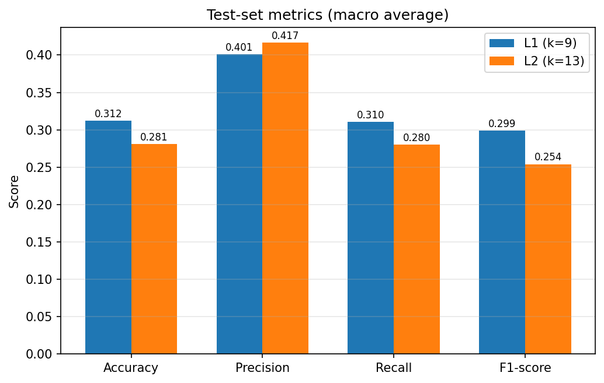

# KNN on CIFAR-10 - Results

**Setup:** 5000 training images (random subset, seed 0), 1000 test images, 5-fold cross-validation, k in [1, 3, 5, 7, 9, 11, 13, 15, 17, 19], distances: L1, L2.

Std = standard deviation of the 5 fold accuracies. Precision / Recall / F1 are macro averages over the 10 classes. The best k per distance is shown in bold.

## 1. Cross-validation (choosing k)

### L1 distance

| k | Mean acc. | Std | Fold 1 | Fold 2 | Fold 3 | Fold 4 | Fold 5 |
|---|---|---|---|---|---|---|---|
| 1 | 0.2848 | 0.0091 | 0.2700 | 0.2810 | 0.2860 | 0.2970 | 0.2900 |
| 3 | 0.2698 | 0.0125 | 0.2640 | 0.2790 | 0.2490 | 0.2850 | 0.2720 |
| 5 | 0.2840 | 0.0095 | 0.2690 | 0.2890 | 0.2820 | 0.2980 | 0.2820 |
| 7 | 0.2854 | 0.0137 | 0.2580 | 0.2940 | 0.2910 | 0.2930 | 0.2910 |
| **9** | **0.2948** | **0.0094** | **0.2780** | **0.2960** | **0.2960** | **0.3070** | **0.2970** |
| 11 | 0.2944 | 0.0111 | 0.2800 | 0.2900 | 0.2930 | 0.2950 | 0.3140 |
| 13 | 0.2860 | 0.0054 | 0.2790 | 0.2870 | 0.2820 | 0.2870 | 0.2950 |
| 15 | 0.2860 | 0.0074 | 0.2760 | 0.2890 | 0.2790 | 0.2900 | 0.2960 |
| 17 | 0.2832 | 0.0088 | 0.2740 | 0.2840 | 0.2760 | 0.2830 | 0.2990 |
| 19 | 0.2832 | 0.0143 | 0.2660 | 0.2730 | 0.2780 | 0.2940 | 0.3050 |

### L2 distance

| k | Mean acc. | Std | Fold 1 | Fold 2 | Fold 3 | Fold 4 | Fold 5 |
|---|---|---|---|---|---|---|---|
| 1 | 0.2572 | 0.0111 | 0.2570 | 0.2400 | 0.2530 | 0.2620 | 0.2740 |
| 3 | 0.2442 | 0.0035 | 0.2480 | 0.2410 | 0.2390 | 0.2460 | 0.2470 |
| 5 | 0.2558 | 0.0096 | 0.2600 | 0.2510 | 0.2440 | 0.2720 | 0.2520 |
| 7 | 0.2566 | 0.0120 | 0.2410 | 0.2630 | 0.2470 | 0.2750 | 0.2570 |
| 9 | 0.2628 | 0.0105 | 0.2430 | 0.2650 | 0.2710 | 0.2720 | 0.2630 |
| 11 | 0.2594 | 0.0103 | 0.2400 | 0.2600 | 0.2620 | 0.2700 | 0.2650 |
| **13** | **0.2634** | **0.0130** | **0.2410** | **0.2700** | **0.2600** | **0.2800** | **0.2660** |
| 15 | 0.2608 | 0.0097 | 0.2460 | 0.2580 | 0.2570 | 0.2700 | 0.2730 |
| 17 | 0.2622 | 0.0138 | 0.2450 | 0.2590 | 0.2510 | 0.2810 | 0.2750 |
| 19 | 0.2628 | 0.0124 | 0.2390 | 0.2660 | 0.2640 | 0.2730 | 0.2720 |

## 2. Test-set results

| Distance | Best k | CV acc. | Test acc. | Precision | Recall | F1-score |
|---|---|---|---|---|---|---|
| L1 | 9 | 0.2948 | 0.3120 | 0.4011 | 0.3104 | 0.2986 |
| L2 | 13 | 0.2634 | 0.2810 | 0.4165 | 0.2800 | 0.2538 |

## 3. Per-class scores on the test set

### L1 (k=9)

| Class | Precision | Recall | F1-score | Support |
|---|---|---|---|---|
| airplane | 0.338 | 0.495 | 0.402 | 103 |
| automobile | 0.750 | 0.202 | 0.319 | 89 |
| bird | 0.182 | 0.320 | 0.232 | 100 |
| cat | 0.328 | 0.214 | 0.259 | 103 |
| deer | 0.184 | 0.422 | 0.256 | 90 |
| dog | 0.354 | 0.198 | 0.254 | 86 |
| frog | 0.295 | 0.232 | 0.260 | 112 |
| horse | 0.567 | 0.167 | 0.258 | 102 |
| ship | 0.413 | 0.717 | 0.524 | 106 |
| truck | 0.600 | 0.138 | 0.224 | 109 |

### L2 (k=13)

| Class | Precision | Recall | F1-score | Support |
|---|---|---|---|---|
| airplane | 0.391 | 0.437 | 0.413 | 103 |
| automobile | 0.800 | 0.135 | 0.231 | 89 |
| bird | 0.172 | 0.330 | 0.226 | 100 |
| cat | 0.348 | 0.155 | 0.215 | 103 |
| deer | 0.185 | 0.533 | 0.274 | 90 |
| dog | 0.333 | 0.116 | 0.172 | 86 |
| frog | 0.245 | 0.214 | 0.229 | 112 |
| horse | 0.733 | 0.108 | 0.188 | 102 |
| ship | 0.343 | 0.698 | 0.460 | 106 |
| truck | 0.615 | 0.073 | 0.131 | 109 |

## 4. Plots

### Cross-validation on k

Each dot is one fold, the line goes through the mean, the bars show the standard deviation.

### L1 vs L2

### Confusion matrices

**L1 (k=9)**

**L2 (k=13)**

### Per-class scores

### Test-set metrics, L1 vs L2

