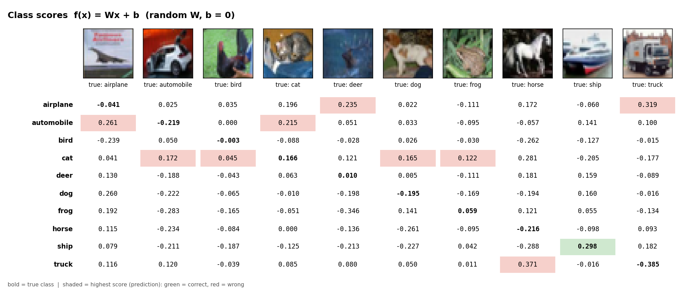
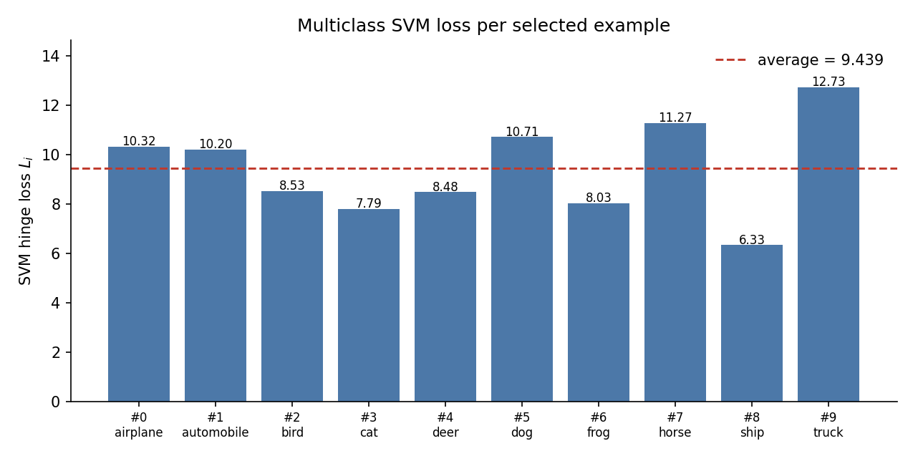
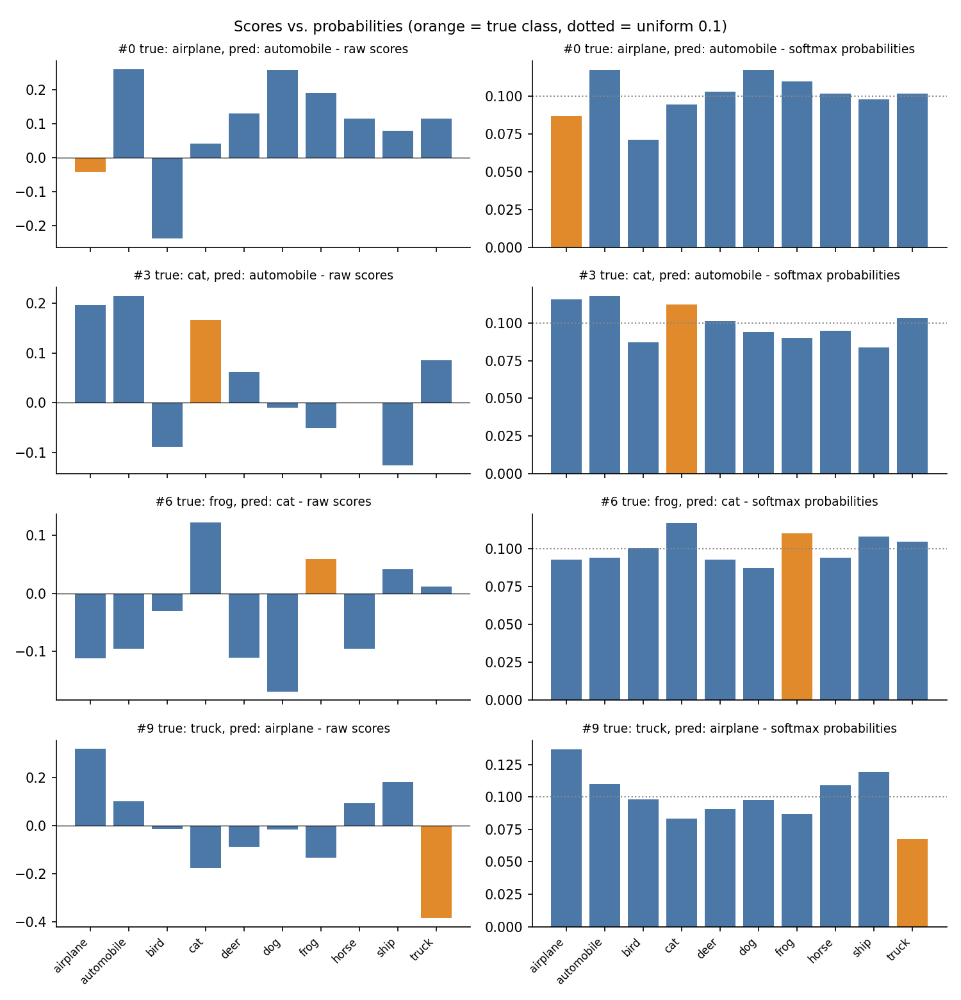
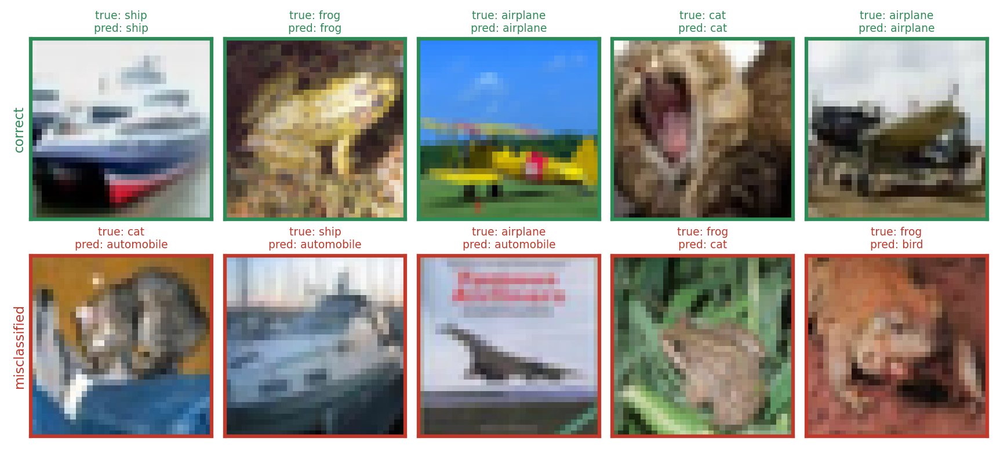
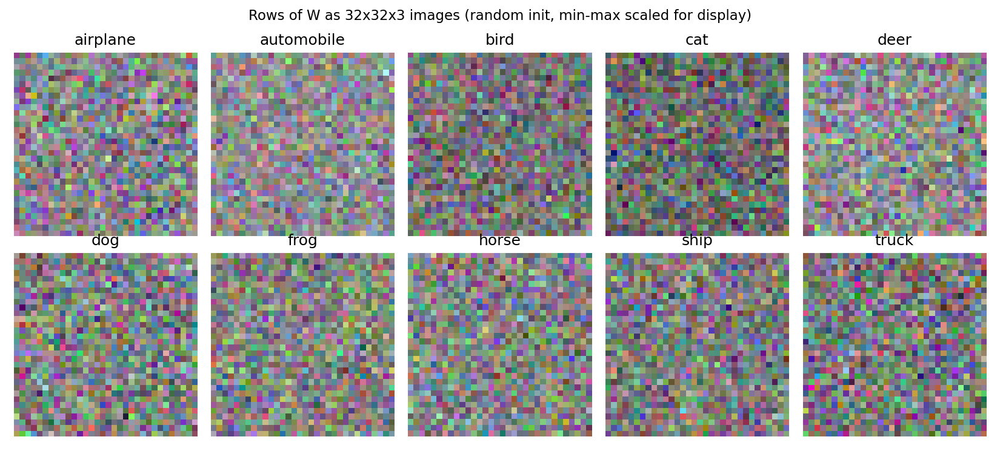
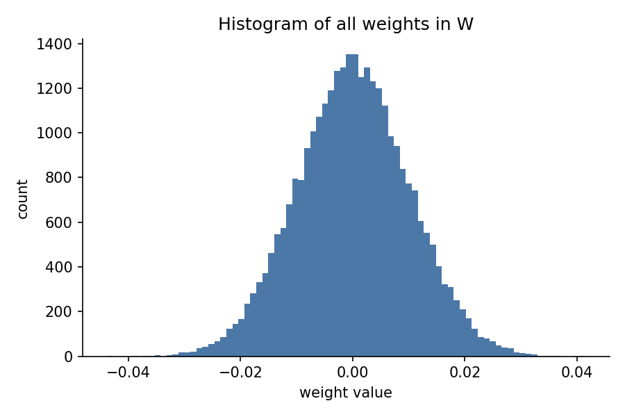

# Linear Classification on CIFAR-10 (random weights, no training)

## 1. Parameters

- Data: CIFAR-10 test batch, pixels scaled to [-0.5, 0.5], flattened to 3072 values.
- Selected examples: first test image of each class (indices `[3, 6, 25, 0, 22, 12, 4, 13, 1, 11]`).
- `W`: shape (10, 3072), `0.01 * N(0,1)`, seed 42 (mean +0.00009, std 0.01004).
- `b`: shape (10,), all zeros.

## 2. Scores f(x) = Wx + b

| class | #0 (airplane) | #1 (automobile) | #2 (bird) | #3 (cat) | #4 (deer) | #5 (dog) | #6 (frog) | #7 (horse) | #8 (ship) | #9 (truck) |
|---|---|---|---|---|---|---|---|---|---|---|
| airplane | **-0.041** | +0.025 | +0.035 | +0.196 | +0.235 | +0.022 | -0.111 | +0.172 | -0.060 | +0.319 |
| automobile | +0.261 | **-0.219** | +0.000 | +0.215 | +0.051 | +0.033 | -0.095 | -0.057 | +0.141 | +0.100 |
| bird | -0.239 | +0.050 | **-0.003** | -0.088 | -0.028 | +0.026 | -0.030 | -0.262 | -0.127 | -0.015 |
| cat | +0.041 | +0.172 | +0.045 | **+0.166** | +0.121 | +0.165 | +0.122 | +0.281 | -0.205 | -0.177 |
| deer | +0.130 | -0.188 | -0.043 | +0.063 | **+0.010** | +0.005 | -0.111 | +0.181 | +0.159 | -0.089 |
| dog | +0.260 | -0.222 | -0.065 | -0.010 | -0.198 | **-0.195** | -0.169 | -0.194 | +0.160 | -0.016 |
| frog | +0.192 | -0.283 | -0.165 | -0.051 | -0.346 | +0.141 | **+0.059** | +0.121 | +0.055 | -0.134 |
| horse | +0.115 | -0.234 | -0.084 | +0.000 | -0.136 | -0.261 | -0.095 | **-0.216** | -0.098 | +0.093 |
| ship | +0.079 | -0.211 | -0.187 | -0.125 | -0.213 | -0.227 | +0.042 | -0.288 | **+0.298** | +0.182 |
| truck | +0.116 | +0.120 | -0.039 | +0.085 | +0.080 | +0.050 | +0.011 | +0.371 | -0.016 | **-0.385** |

| image | true | predicted | correct? |
|---|---|---|---|
| #0 | airplane | automobile | no |
| #1 | automobile | cat | no |
| #2 | bird | cat | no |
| #3 | cat | automobile | no |
| #4 | deer | airplane | no |
| #5 | dog | cat | no |
| #6 | frog | cat | no |
| #7 | horse | truck | no |
| #8 | ship | ship | yes |
| #9 | truck | airplane | no |

1 of 10 selected images are predicted correctly. The scores are small and similar for all classes (std of all scores: 0.160), and the highest one is decided by random correlations between W and the pixels, not by image content.

## 3. Multiclass SVM hinge loss

`L_i = sum_{j != y_i} max(0, s_j - s_yi + 1)`

| image | true | s_true | L_i |
|---|---|---|---|
| #0 | airplane | -0.041 | 10.3226 |
| #1 | automobile | -0.219 | 10.1991 |
| #2 | bird | -0.003 | 8.5261 |
| #3 | cat | +0.166 | 7.7922 |
| #4 | deer | +0.010 | 8.4766 |
| #5 | dog | -0.195 | 10.7110 |
| #6 | frog | +0.059 | 8.0280 |
| #7 | horse | -0.216 | 11.2708 |
| #8 | ship | +0.298 | 6.3300 |
| #9 | truck | -0.385 | 12.7286 |

**Average loss over the 10 selected examples: 9.4385**

Step-by-step hinge loss calculation for image #0 (true = airplane, s_true = -0.041):

| wrong class j | s_j | s_j - s_y + 1 | max(0, .) |
|---|---|---|---|
| automobile | +0.261 | +1.301 | 1.301 |
| bird | -0.239 | +0.802 | 0.802 |
| cat | +0.041 | +1.082 | 1.082 |
| deer | +0.130 | +1.171 | 1.171 |
| dog | +0.260 | +1.301 | 1.301 |
| frog | +0.192 | +1.233 | 1.233 |
| horse | +0.115 | +1.156 | 1.156 |
| ship | +0.079 | +1.119 | 1.119 |
| truck | +0.116 | +1.157 | 1.157 |

Sum = 10.3226 = L_0.

All scores are small and similar, so each of the 9 wrong classes contributes a margin of roughly +1 and the loss is near C - 1 = 9 before any training (a useful sanity check). It varies around 9 because the margins depend on the true-class score: the lower s_true, the larger the loss. Here image #8 (ship, s_true = +0.298) has the lowest loss (6.33) and image #9 (truck, s_true = -0.385) the highest (12.73).

## 4. Softmax

| image | true | predicted | sum of probabilities | max probability |
|---|---|---|---|---|
| #0 | airplane | automobile | 1.0000000000 | 0.1173 |
| #1 | automobile | cat | 1.0000000000 | 0.1294 |
| #2 | bird | cat | 1.0000000000 | 0.1098 |
| #3 | cat | automobile | 1.0000000000 | 0.1177 |
| #4 | deer | airplane | 1.0000000000 | 0.1301 |
| #5 | dog | cat | 1.0000000000 | 0.1196 |
| #6 | frog | cat | 1.0000000000 | 0.1169 |
| #7 | horse | truck | 1.0000000000 | 0.1396 |
| #8 | ship | ship | 1.0000000000 | 0.1291 |
| #9 | truck | airplane | 1.0000000000 | 0.1368 |

All probability sums equal 1 (`np.allclose`: True, also for all 10000 test images). Softmax exponentiates the scores (making them positive) and divides by their sum. The class with the highest score keeps the highest probability. Because the scores are nearly equal, the probabilities are close to uniform (about 0.1, largest 0.140).

## 5. Correct and misclassified examples

Examples are taken from all 10000 test images. Overall the random classifier is correct for 9.8% of them, about chance level (10%). Correct predictions are coincidences: a random template happened to give the true class the highest score. Misclassified images show no pattern, because the weights contain no knowledge about the classes.

## 6. Weight vectors as 32x32x3 images

Each row of W is reshaped to 32x32x3 and min-max scaled for display. The weights were drawn independently from the same Gaussian, so every pixel weight is noise: no shapes, no colour layout, and no difference between the classes. Learned weights look like class templates only because training adjusts them using labelled images. Here the data never influenced W.
